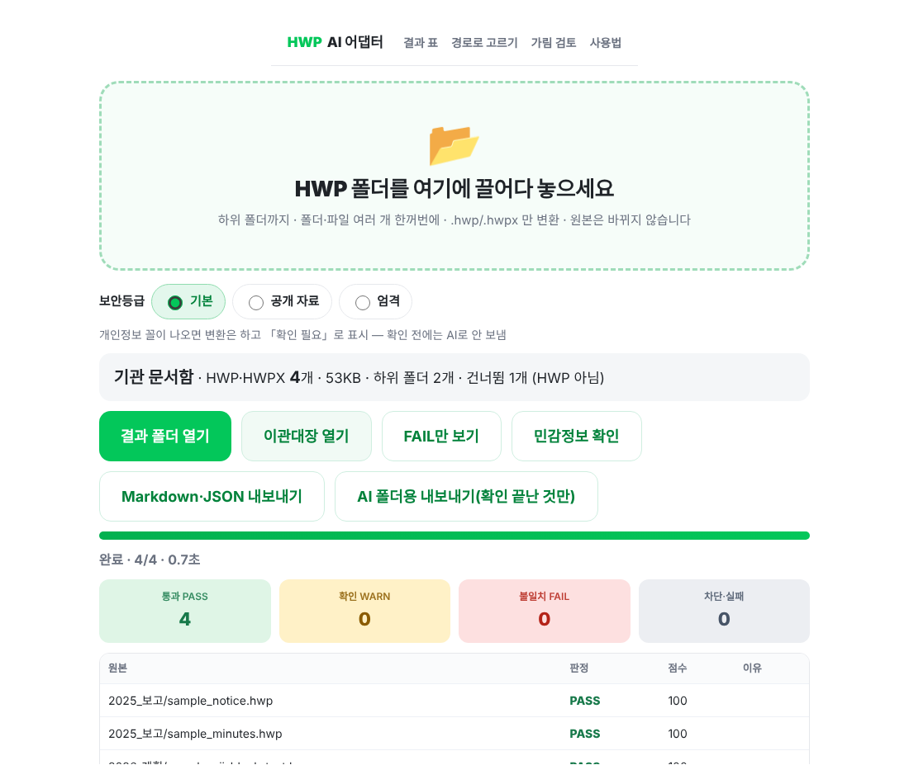

# HWP AI 어댑터 - HWP를 AI가 바로 읽고 HWPX로 바꾸는 어댑터 — 구동 안내서

> 양식 2-1(구동 안내서)의 구분 순서를 따랐다. 화면에 나오는 글자는 「」로 적었다.
>
> **한눈에 보기** — 한글 프로그램 없이 HWP를 HWPX로 옮기고, 옮긴 결과가 원본과 같은지 파일마다 증명한다(검증서·이관대장). 변환본은 Markdown·JSON·RAG 조각으로 바로 AI에 넣는다.
>
> | 확인한 것 | 결과 |
> |---|---|
> | 한글 2024에서 열기(공개 저장소 문서 2,286건) | 변환본 2,286건 모두 열림 · 쪽 수 2,234/2,234 · 글 2,224/2,227 원본과 같음 · 한글이 원본을 못 여는 46건도 변환본은 열림 |
> | 공개 보도자료 1만여 건(60개 기관, 2013~2026) | 10,446건 재측정 PASS 10,437 · 이전보다 나빠진 문서 0 |
> | 같은 표본 438건, 같은 검증 규칙 | 판정 PASS hwpai 437 · 한글 2024 자체 변환 431 · kordoc 436 (전체 비교·장점: 저장소 `docs/benchmark.md` 성능 비교 평가서) |
> | 행정망 PC + 업무망 온AI | 변환 PASS → 3개 모델 질의(Solar Pro 4 · HCX-GOV-THINK-30B · K-EXAONE), 지어낸 답 0(Solar·HCX) |
> | 실행 | 행정망 PC·외부망 PC(Windows)에서 작동, 설치·관리자 권한·인터넷 불필요 |

## 실행 환경
| 항목 | 내용 |
|---|---|
| 운영체제 | Windows 10/11 64비트. 휴대용 폴더에 Python 3.12·Node.js 22가 들어 있어 설치·관리자 권한·인터넷 연결이 필요 없다(행정망 PC에서 그대로 실행). Linux(Python 3.10+·Node.js 18+)에서도 돈다. |
| 브라우저 | 기본 브라우저(Edge·Chrome). 화면은 이 컴퓨터 안(127.0.0.1)에서만 열린다. 끌어놓기가 안 되는 브라우저는 「폴더 선택」을 쓴다. |
| 권장 사양 | 저장 공간: 압축 푼 폴더 약 160MB(zip 약 62MB) + 결과 폴더(원본과 비슷한 크기). 메모리 4GB 이상(변환 일꾼 하나 최대 약 330MB, 동시 변환 수만큼). 속도(제출 코드 재측정 11-11, 동시 2): 공개 HWP 1,000개 변환·검증 Windows 사무용 PC 245초 · 리눅스 2코어 102초. |
| 필요 소프트웨어 | 없음. LLM 질의(선택)만 OpenAI 호환 API 주소가 필요하다. |

## 설치·실행 절차
1. **받기**: 공공 GitLab 저장소의 `hwpai-portable-win64.zip`(SHA256은 저장소 `SHA256SUMS.txt`). zip 하나로 끝난다.
2. **점검**: 아무 폴더에 풀고 `check.bat`을 두 번 누른다. 마지막 줄 「결론: 사용할 수 있습니다.」면 준비 끝. 「[실패]」면 그 아래 「해결:」을 따른다. 「PC 보호」 창이 뜨면 「추가 정보」 → 「실행」(서명 없는 실행 파일이라 뜬다).
3. **첫 실행(끌어놓기 한 번)**: 탐색기에서 `sample_data` 폴더를 `hwpai.bat` 아이콘 위에 놓는다. 끝나면 `sample_data_hwpx변환` 폴더와 `요약.md`가 열린다(변환본·`_검증서/`·`이관대장.xlsx`). 결과: 4건 모두 PASS, 번호가 든 시험 문서 1건은 「확인 필요」.
4. **화면으로 쓰기**: `hwpai.bat`을 두 번 누르면 브라우저에 「HWP AI 어댑터」가 열린다(검은 창은 닫지 않는다). 폴더(하위 폴더 포함)·파일 여러 개를 끌어놓기 → 목록(「HWP·HWPX n개 · 용량 · 하위 폴더 n개 · 건너뜀 n개」) → 「보안등급」(기본·공개 자료·엄격) → 「변환 시작」. 진행 막대·남은 시간·파일별 판정이 실시간으로 나오고, 끝나면 「결과 폴더 열기」·「이관대장 열기」·「FAIL만 보기」. 같은 폴더를 다시 넣으면 끝난 파일은 건너뛴다.
5. **명령으로 쓰기(심사·자동화)**:
   ```
   hwpai.bat doctor                                    설치 점검
   hwpai.bat convert D:\문서함                         일괄 변환 → D:\문서함_hwpx변환
   hwpai.bat drop D:\가 D:\나 D:\다.hwp                 끌어놓기와 같은 일괄 변환(여러 개)
   hwpai.bat ask 문서.hwp "질문" --profiles 모델.json   LLM 질의(아래 LLM 연결 설정)
   ```
6. **민감정보 확인 요청**: 변환·검증은 이 컴퓨터 안에서만 하므로 막지 않는다. 등급이 없는 문서에서 휴대전화·주민등록번호·외국인등록번호·계좌번호·이메일·여권번호 꼴, 「성명:」 표기, 문서 속성(작성자 등)이 나오면 이관대장에 「확인 필요」로 적고, 사람이 확인하기 전에는 AI(`ask`·MCP·`export --ai-folder`)에 보내지 않는다. 확인은 `hwpai.bat sens review 폴더`(검출 값을 문서 위치와 함께 색으로 보여 주는 화면)에서 「민감정보 아님/있음」을 고른다. 결정은 문서 해시로 저장된다. 등급은 기계가 정하지 않는다.

## LLM 연결 설정
- **역할**: LLM은 `ask`(문서에 질문)에만 쓴다. 변환·검증·이관대장은 LLM 없이 동작한다.
- **실제 구동한 모델**

| 경로 | 모델 | 결과 |
|---|---|---|
| 행정망 PC → 업무망 온AI(변환 결과 첨부, 2026-11-09) | FabriX Solar Pro 4 / CLOVA Studio for GOV HCX-GOV-THINK-30B | 8문항 7/8 · 8/8, 지어낸 답 0 |
| 같은 경로, 공고문 2건 30문항 | Solar Pro 4 / K-EXAONE | 28/30 · 25/30 |
| 외부망 공개 API(`ask`, 2026-11-10) | 업스테이지 Solar Pro 4(주최 지원 API) / 네이버 HyperCLOVA X HCX-005 | 같은 근거로 핵심 값 일치 |
| 상용 대화형 서비스 웹 화면(합성 문서 3건) | ChatGPT · Gemini · Claude | 각 3/3 |

  업무망 온AI 두 서비스는 외부 도구(MCP) 등록 기능이 없어 변환 결과를 첨부해 쓴다.
- **설정(파일 하나, 여러 모델)** — 실제로 돌린 설정이다. 열쇠는 파일에 쓰지 않고 환경변수(`set SOLAR_API_KEY=발급받은키`)로 넣는다.
  ```json
  {"profiles": {
    "solar-pro4": {"base_url": "https://api.upstage.ai/v1", "model": "solar-pro4", "api_key_env": "SOLAR_API_KEY"},
    "hcx-005": {"base_url": "https://clovastudio.stream.ntruss.com/v1/openai", "model": "HCX-005", "api_key_env": "CLOVA_API_KEY"}}}
  ```
  모델 하나만 쓸 때는 `HWPAI_LLM_BASE_URL`·`HWPAI_LLM_MODEL`·`HWPAI_LLM_API_KEY`를 정하고 `--profile env`. 교체는 `base_url`·`model`만 바꾼다(행안부 AI 공통기반 API 주소도 같은 칸). 심사위원 PC에서도 Solar Pro 4 키를 넣으면 `hwpai.bat ask sample_data\sample_plan.hwp "2분기 대상 부서 수와 처리 건수는?" --profiles 모델.json`이 그대로 재현된다.
- **출력**: 모델별 답과 근거 조각 번호, 모델 간 비교 한 줄. 문장이 달라도 핵심 값(숫자+단위·날짜·기관명)이 같으면 일치로 본다. 실제 출력: Solar 「2분기 대상 부서 수는 12개, 처리 건수는 8,500건입니다.」, HCX 「2분기에는 12개 부서에서 8,500건의 문서가 처리됩니다.」 → 「핵심 값 일치: 12개 부서 · 8,500건 (예)」. 값이 다르거나 근거 조각에 없는 값이 나오면 「사람 확인」을 붙인다.

## 모의데이터 안내
- 동봉 `sample_data/`: 엔진으로 만든 합성 HWP 4건(실제 기관 문서 아님). 폴더째 `hwpai.bat`이나 화면에 끌어놓는다.
  - `sample_plan.hwp`(업무추진계획, 표 3×3) · `sample_minutes.hwp`(회의결과, 표 3×2) · `sample_notice.hwp`(안내문): 개인정보 없음, PASS. `sample_plan.hwp`는 LLM 질의 예시 문서다.
  - `sample_pii_block_test.hwp`: 쓰지 않는 번호(010-0000-0000)를 넣은 문서. 변환·PASS가 되고 「확인 필요」로 남아 확인 전에는 AI에 보내지 않는다.
- 원본 보호: 원본은 읽기만 한다. 결과는 원본 폴더 밖 「〈폴더〉_hwpx변환」에 쓴다(시험: 원본 해시·수정 시각 불변).

## 기능 사용 순서
1. **폴더째 변환·판정**: 파일마다 HWPX와 검증서를 만들고 PASS·WARN·FAIL을 매긴다. 검증은 변환 엔진과 다른 hwpai 판독기로 원본을 직접 읽어 글·표 칸·그림·각주·수식을 대조한다.
2. **사람 확인**: 「FAIL만 보기」로 거르고 행을 누르면 「검증서」에 차이 위치(문단, 표 행·열, 그림)가 나온다. `이관대장.xlsx`의 「사람확인목록」 시트로 넘긴다(1,000건 시험에서 사람이 볼 문서는 1건).


3. **AI 활용**: `ask`로 문서에 질문(여러 모델 비교)하거나, `hwpai.bat mcp-install`로 Claude 데스크톱 등에 MCP 도구 8개(read_hwp·get_tables·search_chunks·convert_to_hwpx·audit·export_doc·replace_text·fill_form)를 등록한다. AI가 부르는 도구에도 같은 확인 요청이 걸리고, 등급은 사람이 만든 등급 파일(`HWPAI_GRADE_FILE`)에서만 읽는다. 문서 내용은 「데이터」로만 표시해 넘긴다(문서 속 지시문 실행 방지).

## 추가 기능 사용법
| 기능 | 명령 | 설명 |
|---|---|---|
| AI용 내보내기 | `hwpai.bat export 대상 --out 폴더 --formats md,json,chunks` | 화면 「Markdown·JSON 내보내기」, MCP `export_doc`. `--ai-folder`는 확인 끝난 문서만 쓴다. JSON에 표 칸 좌표·병합·그림 해시, AI용에서는 작성자 등 속성을 뺀다 |
| 서식 보존 치환·양식 채우기 | `hwpai.bat replace 문서.hwpx 바꿀글.json` · `fill` | 새 파일과 변경 보고서, 되읽어 확인, 원본 보존 |
| 보존 증명서 | `hwpai.bat cert 원본.hwp 변환.hwpx` | 원본·변환본 해시 + 줄 대조 + 판정 한 장 |
| 시각 비교 | `hwpai.bat visual 원본.hwp 변환.hwpx` | 쪽별 그림을 나란히, 쪽 수·글·그림 대조 |
| AI 친화도·속성 점검 | `aicheck` · `meta [--scrub]` | 병합 칸·설명 없는 그림 등 보고, 작성자 속성 비우기 |
| 첨부 전 자동 변환 | `watch 폴더` · `ctxmenu`(기본 꺼짐) | 새 HWP 자동 변환·검증, 탐색기 우클릭 메뉴(.reg 사람 적용) |
| 구조 검사 | `python\python.exe -m hwpai.hwpxcheck 파일.hwpx` | 한글 없이 HWPX 필수 구조·참조·버전 점검 |
| 웹판 | https://best5218o-ux.github.io/hwpai-web/ 열기, 또는 `hwpai-web.zip`의 `index.html` | 브라우저 안에서만 변환·검증·확인·내보내기(파일은 서버로 안 감). 폴더 감시·MCP·질문 없음 |
| 휴대폰 앱(PWA) | 휴대폰 크롬으로 위 주소 → 「앱 설치」(아이폰: 공유 → 홈 화면에 추가) | 설치 후 인터넷 없이 변환(11-11 시험: 설치 오류 0, 오프라인 4건 변환) |

## 알려진 제약 사항
- **검증 기록**(모두 공개 자료, 측정 코드 판을 함께 적는다)

| 시험 | 결과 |
|---|---|
| 공개 보도자료 1,000건(2017~2021) | 제출 코드 재측정(11-11): PASS 999·FAIL 1(0195), Windows 사무용 PC 245초·리눅스 2코어 102초(동시 2). 「확인 필요」 266건(본문 66·속성만 200) |
| 다른 기관 62건(27개 기관) · 구조 시험 306건 | 62 PASS · PASS 292·WARN 12·FAIL 0 |
| 공개 보도자료 10,501건(2013~2026, 60개 기관) | 처음 측정 PASS 99.91%(95% 신뢰구간 99.84~99.95). 원문을 다시 받아 해시가 같은 10,446건을 C107 코드로 재측정: PASS 10,437·WARN 4·FAIL 4·변환 불가 1, 나빠진 문서 0 |
| 공개 저장소 문서 2,333건(제출 코드 C121) | PASS 2,244·WARN 44·FAIL 1(HWP가 아닌 시험 입력 44건 제외), 이전 판보다 나빠진 문서 0 |
| 한글 13(0,0,3901)과 같은 표본 438건(C93 코드) | 판정 PASS hwpai 437 · 한글 431 · kordoc 436 · hwpConverter 355/405. 한글이 PASS가 아닌 7건은 자동번호 표기·날짜 필드 재계산 같은 표현 차이. 한글 자체 저장이 실패한 8건도 hwpai는 변환 |
| 한글 2024 대량 열기(2,286건) | V8 판 + 스크립트 문서 6건(제출 기본값 재시험) + C120 8건(시험27) + C121 25건(시험29): 모두 열림, 쪽 2,234/2,234, 글 2,224/2,227(남은 3건은 한글이 파일 이름·기호를 새로 쓰는 차이) |
| 독립 채점(hwpai 코드 미사용) · 제3자 스키마 | 글 437/438, 개수 438/438 · python-hwpx 문서 오류 0/446 |

- **한글로 찾아 고친 것**: 숨은 본문(ViewText) 끼어듦, 그림 채운 사각형·묶음 안 OLE(엔진 소스 수정), 쪽번호 위치, 각주 번호, 기호 문자, 교정부호 필드, 변경 추적 이력, 필드 속성·커서 위치·하이픈·다단·단 너비·그림자 여백(한글 2,286건 대량 판정으로 찾은 7종), 한컴이 아닌 생성기의 줄 배치 저장값(C120, 8건 — 일괄 제거는 23건이 어긋나 기각), 옛 한글 조판으로 저장된 수식 크기(C121, 25건 — 한컴 저장본 수식 51,745개 대조로 표지 5종을 찾음, 맞던 수식을 바꾼 일 0).
- **남은 것**: 쪽 수 차이 없음(58edc88128ce 22 대 23쪽은 C121로 해결, 시험29). 구버전 한글·온나라 웹기안기 직접 열기는 하지 않았다(구조 검사만 통과).
- **0195**: 변경 추적으로 지운 글(380자)이 남은 문서. 한글 PDF로 화면 글이 hwpai 변환본과 같음을 확인했고, 검증서는 원본 전체 기준 FAIL과 화면 글 기준 PASS를 함께 보여 준다(공식 판정은 보수적으로 FAIL).
- **개인정보 검출**은 형식 기반이다. 「성명:」 표기 없는 본문 속 이름·주소는 잡지 못한다(필요하면 「엄격」).
- **화면 끌어놓기**는 브라우저가 경로를 주지 않아 HWP를 작업 폴더로 복사한다(파일당 200MB). 원본 옆에 결과를 두려면 「경로로 고르기」나 아이콘 끌어놓기. 폴더 이름에 `&`가 있으면 화면을 쓴다.
- **재배포 제한 구성요소: 없음.** rhwp 소스 빌드(MIT, 4개 파일 수정), Python 3.12 embed(PSF), Node.js 22(MIT), olefile·cryptography·cffi·pycparser. 판·고지는 `NOTICE`·`THIRD_PARTY_LICENSES.md`.

## 개발 경위 요약
기관이 쌓아 온 HWP를 HWPX로 옮기면 글이나 표 칸이 빠지거나 바뀌어도 사람이 한 건씩 맞춰 보기 어렵다. 그래서 변환보다 **증명**을 앞에 두었다: 원본 HWP를 변환 엔진과 다른 판독기로 다시 읽어 변환본과 대조하고, 판정과 근거를 검증서·이관대장으로 남긴다. 공개 보도자료 1,000건으로 반복 측정하며 그림 누락, 화면에 없는 글의 끼어듦, 배포판 엔진의 거짓 PASS를 찾아 고쳤고(엔진은 소스 빌드로 교체), 다음에는 검증기 자체를 의심했다 — hwpai 코드를 쓰지 않는 독립 채점기, 제3자 스키마 검사, 그리고 한글 2024로 2,286건을 원본·변환본 모두 열어 비교해 결함 7종과 저장값 문제 2종(줄 배치·수식 크기)을 더 찾아 고쳐 쪽 수까지 2,234/2,234 원본과 같게 맞췄다. 현장에서는 폴더를 끌어다 놓기만 하면 되고, 행정망에서는 변환 결과를 업무망 온AI 모델 3종에 넣어 실제로 썼다.
